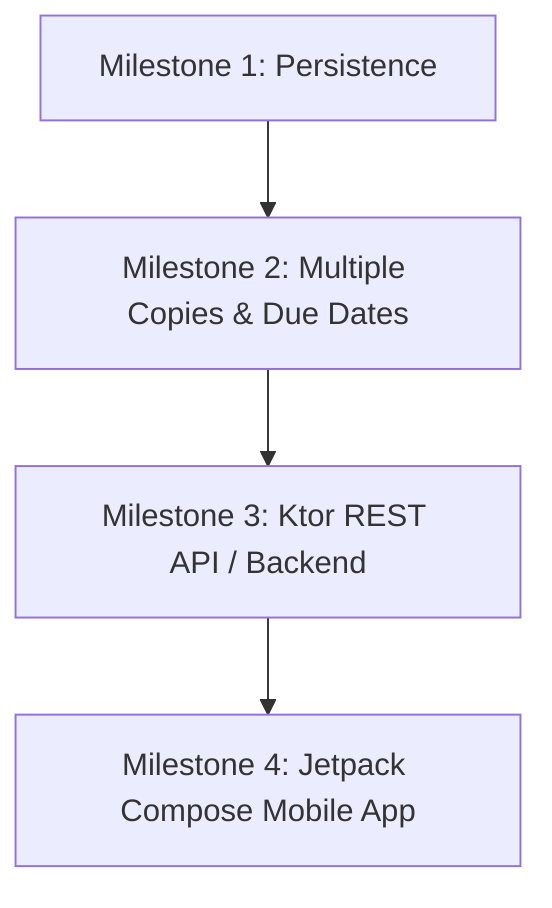

# 🗺️ Future Enhancements & Engineering Roadmap

> **Target Audience**: Next batch of Kotlin & Mobile Development Students  
> **Course**: Advanced Kotlin Programming / Android Application Pathway  
> **Project**: Library Management System (Kotlin & Gradle)  
> **Prepared By**: Ruhama ([Ruhama27](https://github.com/Ruhama27))  

---

## 🎯 Overview

While the current system implements a clean, layered architecture with robust in-memory storage, complete input validation, and 100% test coverage for core workflows, there are numerous natural avenues for architectural expansion.

This document outlines a structured engineering roadmap, technical limitations to overcome, and progressive milestones for future students to tackle.

---

## 🚧 1. Remaining Technical Limitations

| Limitation | Impact | Proposed Architectural Solution |
| :--- | :--- | :--- |
| **In-Memory Volatility** | All books, patrons, and borrow history are lost when the JVM process exits. | Introduce a persistent repository layer using **JSON/File Serialization** or **SQLite / Room / Exposed ORM**. |
| **Single Copy per ISBN** | The library can only store a single copy of any given title; `isAvailable` is boolean. | Refactor `Book` to support an integer `totalCopies` and `availableCopies`, or create a distinct `BookCopy` entity with unique barcode/copy IDs. |
| **No Timestamps or Due Dates** | Borrowing has no concept of borrow duration, due dates, late returns, or overdue penalties. | Introduce `BorrowRecord(patronId, isbn, borrowDate, dueDate, returnDate)` using `java.time.LocalDate`. |
| **Synchronous CLI Only** | The application is single-user and operates synchronously through stdin/stdout. | Migrate to a RESTful Kotlin backend (using **Ktor** or **Spring Boot**) or an Android UI (using **Jetpack Compose**). |
| **Thread Safety** | In-memory `LinkedHashMap` is not synchronized against concurrent modifications. | Use `ConcurrentHashMap` or Kotlin Mutex/Coroutines for thread safety. |

---

## 💡 2. Features That Are Still Missing

### Milestone 1: Due Dates & Overdue Fines
- **Due Date Tracking**: When borrowing a book, calculate a default 14-day loan period.
- **Overdue Check**: Add an option in the menu: `Check Overdue Books`.
- **Fines Calculation**: Calculate daily penalty charges (e.g., $0.50/day) for late returns.

### Milestone 2: Book Inventory & Multiple Copies
- Change data model:
  ```kotlin
  data class Book(
      val isbn: String,
      val title: String,
      val author: String,
      val year: Int,
      val totalCopies: Int = 1,
      val availableCopies: Int = 1
  )
  ```
- Allow multiple patrons to borrow the same title concurrently until `availableCopies == 0`.

### Milestone 3: Patron Profiles & Contact Info
- Extend `Patron` to include:
  - `email: String`
  - `phone: String`
  - `membershipDate: LocalDate`
  - `accountStatus: Active / Suspended`
- Implement email format validation using regex (`^[A-Za-z0-9+_.-]+@(.+)$`).

### Milestone 4: Reservations / Waitlist System
- If a book is completely checked out, allow patrons to place a **hold / reservation**.
- When the book is returned, automatically reserve it for the next patron in the queue (FIFO queue).

---

## ⚡ 3. Usability, Performance & Maintainability Improvements

### 1. Terminal User Interface (TUI) Improvements
- **Colorization**: Integrate ANSI terminal colors (e.g., green for available, red for borrowed/error, yellow for warnings).
- **Pagination**: For libraries with hundreds of books, implement page-by-page viewing (`Page 1 of 10 [Next: n, Prev: p]`).
- **Confirmation Prompts**: Ask `Are you sure? (y/N)` before removing books or updating critical records.

### 2. Architectural Refactoring: Dependency Injection
- Introduce **Koin** or **Dagger/Hilt** to inject repository dependencies into services and handlers rather than manual instantiation in `ConsoleApp.kt`.
- This enables seamless swapping between `InMemoryLibraryRepository`, `SqliteLibraryRepository`, and `NetworkLibraryRepository`.

### 3. File Persistence (JSON & SQLite)
- Add a new repository implementation: `JsonFileLibraryRepository` using `kotlinx.serialization`.
- Automatically save state on shutdown via JVM Shutdown Hook (`Runtime.getRuntime().addShutdownHook(...)`).

---

## 🏆 4. Recommended Milestones for Future Student Teams



### 🏁 Milestone 1: File Storage with `kotlinx.serialization`
- **Objective**: Ensure library data survives between runs.
- **Deliverable**: Data saved in `data/books.json` and `data/patrons.json`.

### 🏁 Milestone 2: Domain Expansion (Due Dates & Reservations)
- **Objective**: Model realistic lending policies and overdue tracking.
- **Deliverable**: Full loan history with overdue reporting.

### 🏁 Milestone 3: Web API with Ktor
- **Objective**: Transform this console app into a modern microservice.
- **Deliverable**: REST endpoints (`GET /books`, `POST /borrow`, `GET /patrons/{id}`).

### 🏁 Milestone 4: Android App with Jetpack Compose
- **Objective**: Build a mobile client connecting to this library system.
- **Deliverable**: An Android APK with barcode scanning via CameraX to scan ISBNs directly from physical books!
